# DropPutt

A multi-franchise hyperlocal delivery platform for semi-urban and rural markets
(first franchise: Kizhissery, Kerala). Local shops call a rider with one tap,
customers order from a mobile storefront, riders navigate by Magic Link and
voice directions, and every rupee is split and reconciled per order.

- **Specification:** [SPEC.md](SPEC.md) — the authoritative rules this code implements
- **Deployment guide:** [DEPLOY.md](DEPLOY.md)
- **Tests:** [backend/test/README.md](backend/test/README.md)

---

## Contents

1. [What it does](#1-what-it-does)
2. [Quick start (development)](#2-quick-start-development)
3. [System architecture](#3-system-architecture)
4. [Multi-tenancy](#4-multi-tenancy)
5. [Roles and screens](#5-roles-and-screens)
6. [End-to-end workflows](#6-end-to-end-workflows)
7. [Order lifecycle](#7-order-lifecycle)
8. [Money model](#8-money-model)
9. [Real-time layer (Socket.io)](#9-real-time-layer-socketio)
10. [Authentication and security](#10-authentication-and-security)
11. [Data model](#11-data-model)
12. [API reference](#12-api-reference)
13. [Background jobs](#13-background-jobs)
14. [Production topology](#14-production-topology)
15. [Configuration](#15-configuration)
16. [Testing](#16-testing)
17. [Repository layout](#17-repository-layout)
18. [Status and known gaps](#18-status-and-known-gaps)

---

## 1. What it does

| Who | What they do |
|---|---|
| **Vendor** (hotel, bakery, shop) | Taps **Call Rider Now**, toggles menu items and shop open/closed, sees live order status and what the platform owes them. |
| **Rider** | Goes online, hears a looping alarm for new orders, accepts, photographs the bill, confirms the customer, delivers, and watches earnings and cash in hand. |
| **Customer** | Orders from `/shop` without an account, then uses a private **Magic Link** page to share location, record a voice route, add a tip and watch the rider arrive on a live map. |
| **Franchise admin** | Live fleet radar, nightly cash settlement with riders, launch-promo and rain-surge switches, royalty wallet, and a reconciliation report. |
| **Super Admin** | Creates and suspends franchises, tops up their royalty wallets, and can work inside any franchise. |

Design choices for the rural setting: PIN login (no passwords or OTP), a Malayalam
indoor-GPS warning when location accuracy is weak, voice-recorded directions as a
fallback, offline GPS queueing on the rider's phone, and a light customer page
(its own code is about 7 KB compressed; it loads only the shared app shell and the
map library, never the admin, rider or vendor code).

---

## 2. Quick start (development)

**Needs:** Node.js 20.12 or newer, Docker (for PostgreSQL).

```bash
# 1. Database (port 5433 so it never clashes with a system Postgres)
docker run -d --name dropputt-postgres -p 127.0.0.1:5433:5432 \
  -e POSTGRES_USER=dropputt -e POSTGRES_PASSWORD=change-me -e POSTGRES_DB=dropputt \
  -v dropputt-pgdata:/var/lib/postgresql/data postgres:16

# 2. Backend
cd backend
cp .env.example .env          # set DATABASE_URL, JWT_SECRET (32+ chars), SEED_DEFAULT_PIN
npm install
npx prisma migrate deploy     # create the tables
npx prisma db seed            # demo franchise, vendors, riders, zones, menus
npm run dev                   # API + Socket.io on http://localhost:3000

# 3. Frontend (new terminal)
cd frontend
npm install
npm run dev                   # http://localhost:5173 (proxies /api, /socket.io, /uploads)
```

Open <http://localhost:5173/login>. The page has one-tap demo buttons for each
role; the seeded accounts use the PIN in `SEED_DEFAULT_PIN`.

| Demo account | Phone |
|---|---|
| Super Admin (login with franchise slug `admin`) | 9000000001 |
| Franchise Admin | 9000000002 |
| Vendor — Farsa Hotel | 9000000011 |
| Rider — Ameen | 9000000021 |

The storefront is at <http://localhost:5173/shop>.

**Trying franchises by hostname:** the app reads the franchise from the hostname
(`kizhissery.localhost:5173`, `admin.localhost:5173`). Plain `localhost` and IP
addresses use the default franchise `kizhissery`.

**Testing on a phone** (GPS and microphone need HTTPS): `cloudflared tunnel --url http://localhost:5173`.
Vite already allows tunnel hostnames, and the app uses same-origin URLs, so one
tunnel carries the page, API, sockets and uploads.

---

## 3. System architecture

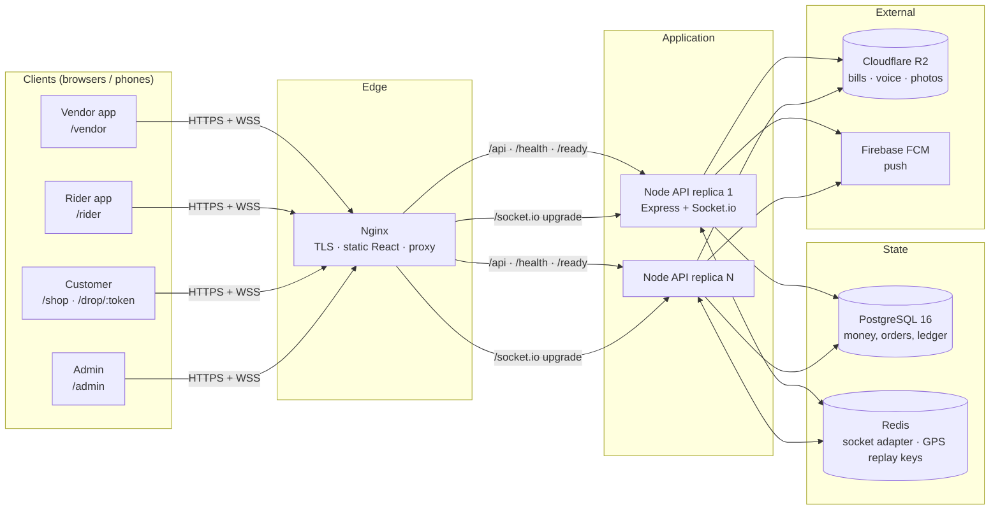

**Backend** (`backend/`): Node.js, Express 4, Prisma 5 on PostgreSQL, Socket.io,
zod for validation, argon2 for PIN hashing, `node-cron` for schedules. Every
money value is a decimal string handled with `decimal.js`; nothing in the
money path uses floating point.

**Frontend** (`frontend/`): React 18, Vite 5, Tailwind CSS, react-router,
axios, socket.io-client, Leaflet. Each app (admin, rider, vendor, customer,
shop) is a lazily loaded chunk, so a customer on a slow rural connection
downloads only their own screen.

**Request path through the API**

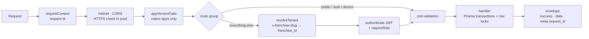

All responses use one envelope: `{ success, data | error, meta: { request_id, timestamp, version } }`.
Lists use cursor pagination (`meta.pagination.next_cursor`, `limit` capped at 100).

---

## 4. Multi-tenancy

One database, many franchises. The rule that matters: **the server decides the
franchise; the client's `franchise_id` is never trusted.**

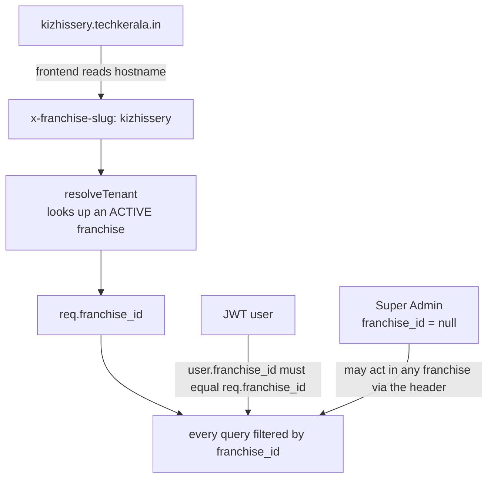

- `admin.<domain>` selects the global Super Admin on login.
- Customers are unique per **(franchise, phone)**; the same number can exist in two franchises.
- Users, orders, products, wallet and ledger rows all carry `franchise_id`.
- Sockets: rooms are chosen by the server from the verified token, never by the client.
- Magic Link pages work from a long random token; the token resolves to its own franchise.

---

## 5. Roles and screens

| Role | Login | Lands on | Can reach |
|---|---|---|---|
| `VENDOR` | phone + PIN | `/vendor` | `/vendor/history` |
| `RIDER` | phone + PIN | `/rider` | `/rider/earnings` |
| `FRANCHISE_ADMIN` | phone + PIN | `/admin` | its own franchise only |
| `SUPER_ADMIN` | phone + PIN at `admin.<domain>` | `/admin` | every franchise, plus the Franchises tab |
| Customer | none | `/shop`, `/shop/:vendorId`, `/drop/:token` | Magic Link = the credential |

| Screen | Highlights |
|---|---|
| `/shop` | Storefront home: sticky nav with search, delivery-area picker and cart; category filter; 4 PM Chayakadi combos pinned 15:00–18:00 IST; items orderable now; open shops; one-shop cart with cash-on-delivery checkout. |
| `/shop/:vendorId` | One shop's full menu with in-menu search: what can be ordered now, plus sold-out and out-of-slot items greyed out with when they return. |
| `/drop/:token` | Hotel and rider details, bill breakdown, **Share My Current Location**, hold-to-record voice route, turning-point landmark, tips (+₹10/20/30), live map with the rider's bike gliding toward the home pin. |
| `/vendor` | Giant pulsing **Call Rider Now**, live order board, menu and shop toggles. |
| `/vendor/history` | Delivered orders and what DropPutt owes the shop (or the shop owes DropPutt). |
| `/rider` | Online switch, cash-in-hand and daily-milestone bars, alarm modal, 4-field pickup form, active delivery card with map, offline GPS queue. |
| `/rider/earnings` | Today / 7 / 30 days, per-day bars, delivered orders. |
| `/admin` | Fleet Radar · Settlement · Promo & Surge · Wallet · Reconcile · Franchises (Super Admin). |

---

## 6. End-to-end workflows

### 6.1 Order, delivery and settlement (the main flow)

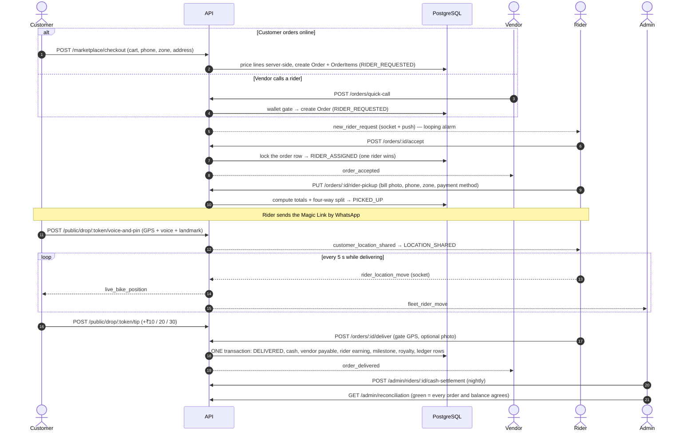

### 6.2 Customer location and voice route

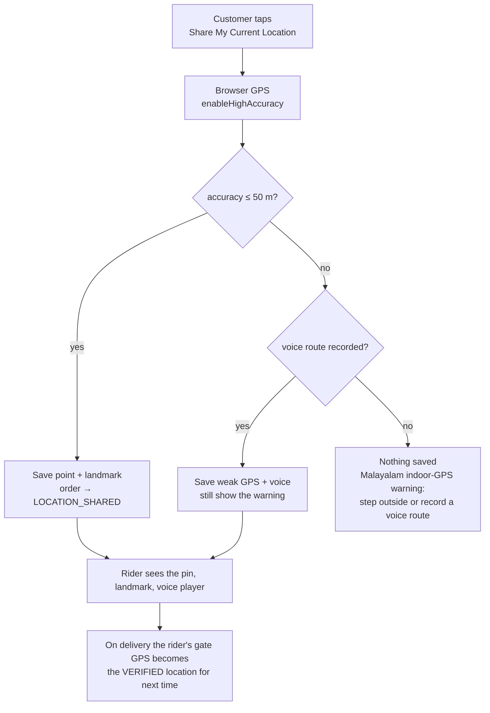

A rider-verified gate location stays the navigation target; a customer's raw pin
never overwrites it. Next order, the rider sees **✅ Verified Gate Location**.

### 6.3 Rider offline GPS and reconnect

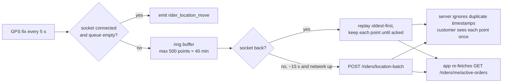

### 6.4 The 4 PM Chayakadi window

At **15:00–18:00 Asia/Kolkata** the feed pins `☕ 4 PM Chayakadi & Coolbar Combos`
first, snack products lead each shop, and an all-snacks cart uses the ₹80
minimum. The backend recomputes the window from a timezone-aware clock and
re-checks availability, slot and minimum at checkout — the UI is never the
authority. At 16:00 a scheduled push goes to each franchise's customer devices.

### 6.5 Franchise onboarding

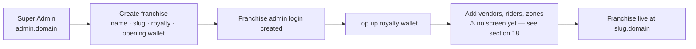

### 6.6 Nightly cash settlement

Riders collect cash on delivery. `cash_in_hand` grows with each delivery; at the
rider's limit (default ₹1,500) the rider cannot accept new orders or go online.
Each night the admin hands over the cash and records it under **Settlement**,
which reduces `cash_in_hand` (idempotent by `Idempotency-Key`) and unlocks the rider.

---

## 7. Order lifecycle

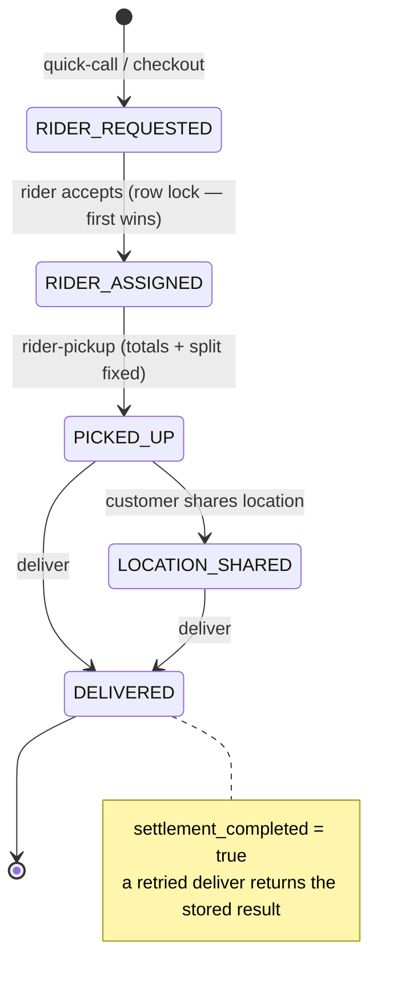

`CANCELLED` exists in the schema but there is no cancel endpoint yet.

**Concurrency guarantees**

- Acceptance runs inside a transaction with `SELECT … FOR UPDATE` on the order: two riders accepting at once → exactly one `200`, the other `409 ORDER_ALREADY_ACCEPTED`.
- Locks are always taken in the order **Order → Rider → Vendor → Franchise** to avoid deadlocks.
- Mutating requests honour an `Idempotency-Key` (cached 24 h); money events also carry deterministic reference keys (`order:{id}:royalty`, `…:vendor-payable`, `…:tip:{action}`), so a retry never pays twice.

---

## 8. Money model

For an order: `grand_total = item_total + delivery_fee + rider_tip − discount`.

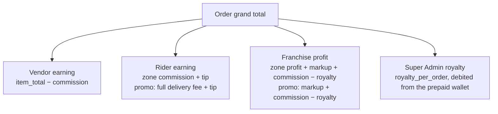

The four shares always add up to the order total (a unit test checks this for
every payment method in both modes).

| Payment method | Rider collects | Vendor ledger |
|---|---|---|
| `COD` | grand total | platform owes vendor its earning |
| `PREPAID_AT_HOTEL` | delivery + tip only | vendor owes the platform its commission |
| `UPI_TO_ADMIN` | nothing | platform owes vendor its earning |

- **Rain surge:** a franchise-set amount added to the rider's tip **once per order** (even if pickup is called twice).
- **Tips:** only ₹10 / ₹20 / ₹30; the same customer action again changes nothing.
- **Daily milestone:** at exactly N deliveries in an IST day the rider gets a bonus, once per rider/day/target.
- **Royalty wallet:** each delivery debits the royalty; at the minimum balance (default −₹50) new orders are refused with `FRANCHISE_WALLET_LOW`.
- **Reconciliation:** every delivered order's split and ledger entries are checked against its totals, and the stored balances of the wallet, each rider and each vendor are compared with the sum of their ledger rows. Discrepancies are listed per order.

---

## 9. Real-time layer (Socket.io)

Connection auth is in the handshake (never the query string):
`{ token }` for staff/riders, `{ location_token }` for a customer's Magic Link,
plus `{ franchise_slug }` for a Super Admin watching one franchise.

| Room | Members |
|---|---|
| `franchise:{id}` | that franchise's admins |
| `franchise:{id}:riders` | its riders |
| `rider:{id}` · `vendor:{id}` | one rider / one vendor |
| `order:{id}` | the assigned rider + customers holding that order's link |

| Event | From → to |
|---|---|
| `new_rider_request`, `addon_order_alert` | server → eligible riders (alarm) |
| `order_taken` | server → other riders when one accepts |
| `order_accepted`, `order_picked_up`, `order_delivered`, `order_status_changed` | server → vendor / admin / order room |
| `rider_location_move` | rider → server (every 5 s, acked) |
| `live_bike_position` | server → customer (no rider identity) |
| `fleet_rider_move`, `fleet_rider_status` | server → franchise admins (Fleet Radar) |
| `rider_fleet_ping` | idle online rider → server (every 20 s, so the radar shows them) |
| `customer_location_shared`, `tip_added` | server → rider |
| `milestone_achieved`, `franchise_settings_changed` | server → rider / admins |

With several API replicas, the Redis adapter carries events between them and GPS
replay protection (duplicate timestamps) is shared through Redis.

---

## 10. Authentication and security

- **PIN login** (4–12 chars), hashed with **argon2**; unknown phone and wrong PIN give the same answer and take the same time. Wrong PINs are rate-limited per account.
- **Access token** (JWT, 15 min) + **refresh token** (30 days, stored as SHA-256, rotated on every use). Reusing an old refresh token revokes the user's whole token family.
- A deactivated user, or a changed role/franchise, stops working immediately (the user is re-read on every request and socket connect).
- **Magic Links** are random 24-byte tokens; their writes are rate-limited per link; the public page never exposes rider phone, KYC, or any money split.
- **Uploads:** type and size validated (images 5 MB, voice 10 MB); stored in R2 in production under unguessable keys.
- **Input:** every body is validated with zod; database ids are capped at 32 bits; Prisma errors are never returned to clients.
- **Transport:** production rejects plain HTTP (`HTTPS_REQUIRED`), Nginx adds HSTS and a Content-Security-Policy, CORS is closed by default.
- **Audit:** every financial mutation writes a structured JSON log line (`"level":"audit"`).
- **Native apps** may send `X-App-Version`; older builds get `403 APP_UPDATE_REQUIRED` (the minimum is configuration, not code).

---

## 11. Data model

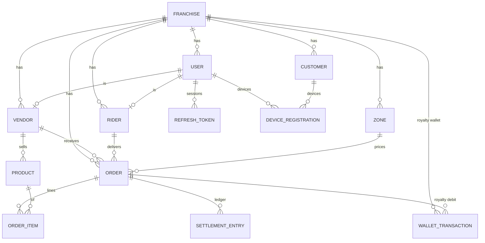

Key points: money columns are `Decimal(12,2)`; `SettlementEntry` rows (with a unique
`reference_key`) and `WalletTransaction` rows are the append-only ledger that
reconciliation checks; `IdempotencyRecord` doubles as the cron run-once lock.
Full schema: [backend/prisma/schema.prisma](backend/prisma/schema.prisma).

---

## 12. API reference

Base path `/api/v1`. Send `x-franchise-slug` (the frontend sets it from the hostname);
authenticated routes need `Authorization: Bearer <access token>`.

| Area | Endpoints |
|---|---|
| **Auth** | `POST /auth/login` · `POST /auth/refresh` · `POST /auth/logout` |
| **Storefront** (public) | `GET /marketplace/feed` · `GET /marketplace/zones` · `POST /marketplace/checkout` |
| **Magic Link** (public, token = credential) | `GET /public/drop/:token` · `GET …/status` · `POST …/voice-and-pin` · `POST …/tip` |
| **Orders** | `POST /orders/quick-call` · `POST /orders/:id/accept` · `PUT /orders/:id/rider-pickup` · `POST /orders/:id/deliver` · `POST /orders/:id/gate-photo` · `GET /orders` (history) · `GET /orders/active` · `GET /orders/zones` · `GET /orders/customer-lookup` |
| **Rider** (`/rider` and `/riders`) | `GET /me` · `PATCH /me/online` · `GET /me/active-orders` · `POST /location-batch` · `GET /earnings` |
| **Vendor** | `GET /vendor/me` · `PATCH /vendor/products/:id` · `PATCH /vendor/shop` · `GET /vendor/ledger` |
| **Admin** | `GET /admin/overview` · `GET /admin/riders` · `POST /admin/riders/:id/cash-settlement` · `PATCH /admin/franchise/settings` · `POST /admin/franchise/wallet/top-up` (Super Admin) · `GET /admin/wallet-transactions` · `GET /admin/reconciliation` · `GET /admin/reconciliation/orders` |
| **Super Admin** | `GET/POST /super/franchises` · `PATCH /super/franchises/:id` |
| **Customers & devices** | `POST /customers` (admin/vendor) · `POST /device/register` |
| **Ops** | `GET /health` (liveness) · `GET /ready` (database + Redis) |

**Error codes:** `UNAUTHENTICATED`, `TOKEN_EXPIRED`, `FORBIDDEN`, `FRANCHISE_INACTIVE`,
`FRANCHISE_WALLET_LOW`, `ORDER_NOT_FOUND`, `ORDER_ALREADY_ACCEPTED`, `ORDER_ALREADY_DELIVERED`,
`VALIDATION_ERROR` (422), `CASH_LIMIT_EXCEEDED`, `MAX_ORDERS_EXCEEDED`, `INVALID_TIP_AMOUNT`,
`CUSTOMER_EXISTS`, `RATE_LIMITED`, `HTTPS_REQUIRED`, `APP_UPDATE_REQUIRED`, `NOT_READY`, `INTERNAL_ERROR`.

---

## 13. Background jobs

All schedules run in **Asia/Kolkata** and take a database run-once lock
(`cron:<job>:<minute>`), so any number of replicas can run them safely.

| Job | When | What |
|---|---|---|
| Push campaigns | 16:00 daily | "☕ 4 PM Snacks Ready!" to each franchise's active customer devices (batches of 500; dead tokens are deactivated) |
| Maintenance (daily) | 03:30 | Purge expired idempotency records and refresh tokens (7-day grace) |
| Maintenance (weekly) | Sun 03:45 | Purge inactive device registrations older than 90 days |
| Database backup | nightly (compose `backup` service) | Compressed dump to `./backups`, 14 days kept |

---

## 14. Production topology

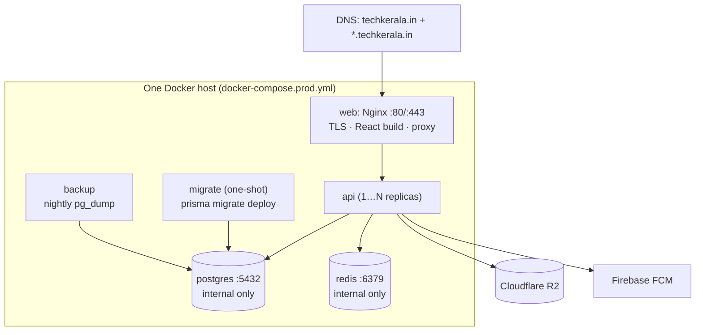

Start order is enforced: Postgres + Redis healthy → migrations → API ready → Nginx.
Setup, TLS, scaling, backups, upgrades and the security checklist are in [DEPLOY.md](DEPLOY.md).

---

## 15. Configuration

Backend settings live in `backend/.env` (copy `.env.example`). The important ones:

| Variable | Purpose |
|---|---|
| `DATABASE_URL` | PostgreSQL connection |
| `JWT_SECRET` | 32+ random characters (required in production) |
| `TRUST_PROXY` | Number of proxies in front of the API (1 = Nginx, 2 = Cloudflare + Nginx) |
| `CORS_ORIGINS` | Allowed browser origins (empty = same-origin only in production) |
| `REDIS_URL` | Only with more than one API replica |
| `FIREBASE_SERVICE_ACCOUNT_PATH` | Enables push notifications |
| `R2_*` | Cloudflare R2 media storage |
| `MIN_APP_VERSION[_ANDROID/_IOS]`, `APP_STORE_URL_*` | Native-app version gate |
| `REQUIRE_HTTPS` | `false` only if TLS cannot be detected behind your proxy |
| `ENABLE_CRON` | Run the schedulers in this process |
| `SEED_DEFAULT_PIN` | PIN given to every **demo** seed user (development only) |

Frontend: `VITE_DEV_PROXY_TARGET` (dev backend, default `http://localhost:3000`),
`VITE_DEFAULT_FRANCHISE_SLUG`. Leave `VITE_API_ORIGIN` unset so the browser stays same-origin.

Production uses `deploy/compose.env` and `deploy/api.env` (templates in `deploy/`).

---

## 16. Testing

```bash
cd backend
npm test            # prepares the dropputt_test database, runs all 172 tests (~50 s)
npm run test:unit   # pure money/time logic, no database (~0.2 s)
```

Tests use Node's built-in runner against a **separate** `dropputt_test` database
(the helper refuses any database whose name does not end in `_test`) and start the
real app on a random port. They cover the spec's required cases: tenant isolation,
auth and token rotation, the rider race, promo/normal/rain/tip/cash math, delivery
retry and milestone, marketplace rules, GPS accuracy, offline GPS flush, push,
pagination, reconciliation, socket isolation, role guards, and the cron lock.
Details: [backend/test/README.md](backend/test/README.md). CI is in `.github/workflows/ci.yml`.

---

## 17. Repository layout

```
DropPutt/
├── SPEC.md                    authoritative specification
├── DEPLOY.md                  production guide
├── docker-compose.prod.yml    production stack
├── deploy/                    Nginx template, env templates, backup script, cert/secret folders
├── .github/workflows/ci.yml   tests + builds
├── backend/
│   ├── prisma/                schema, migrations, demo seed
│   ├── scripts/               create-super-admin, test-db preparation
│   ├── src/
│   │   ├── app.js · server.js Express app and process entry
│   │   ├── config/            env, prisma, redis
│   │   ├── middleware/        auth, tenant, idempotency, rate limits, uploads, HTTPS, app version
│   │   ├── routes/            auth, orders, marketplace, public, rider, vendor, admin, super, customers, device
│   │   ├── services/          dispatch, cart, reconciliation
│   │   ├── socket/            Socket.io handler and rooms
│   │   ├── cron/              schedules and the run-once lock
│   │   └── utils/             order math, time/slots, push, storage, pagination, validation
│   └── test/                  unit + integration tests
└── frontend/
    └── src/
        ├── pages/             Login, Storefront (ShopHome, ShopMenu), CustomerDrop, Rider*, Vendor*, Admin
        ├── components/        admin/ rider/ customer/ shop/ and shared pieces
        ├── hooks/             sockets, rider tracking, fleet ping, cart
        └── utils/             api client, formatting, image, alarm
```

---

## 18. Status and known gaps

All ten build phases are complete and verified (172 automated tests pass; the
production stack was run end to end with two API replicas).

Known gaps, most important first:

1. **No onboarding screens for vendors, riders and zones.** They exist only through the demo seed or direct database inserts. A real launch needs a Vendors / Riders / Zones admin section (KYC upload and rider approval belong here too).
2. **No order cancellation** and no customer-facing order history.
3. **Cash settlements are audit-logged but not written to the ledger table**, so rider `cash_in_hand` cannot be reconciled the way wallet and earnings can.
4. **Customer checkout is cash-on-delivery only.** The customer tracking page does not list the ordered items.
5. **Rate limits are per API replica** (N replicas → up to N× the configured limit).
6. **Native mobile apps** (SPEC §53) are not built; the backend already supports them (device registration, version gate, offline batch, deep-link push payloads).
7. Push, R2 uploads and real TLS certificates have not been exercised against live services; `DEPLOY.md` covers setting them up.
